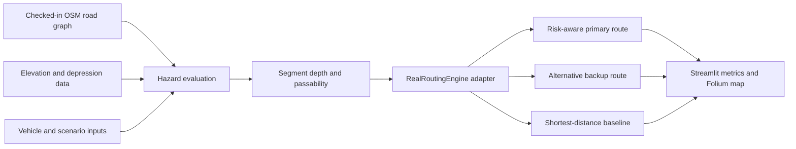

# Rakshapath

**AI-Assisted Emergency Routing and Disaster Response**

*Safer Routes. Smarter Rescue. Stronger India.*

Rakshapath explores how hazard-aware routing could support emergency response during natural disasters. Its current prototype is a regional pilot for the Daraganj riverbank corridor in Prayagraj, Uttar Pradesh. It combines a cached OpenStreetMap road network, terrain elevations and scenario-based hazard models to compare routes for different emergency vehicles. Nationwide coverage is a development goal, not a current capability.

## The problem

The geometrically shortest road path may pass through low-lying or flood-affected segments. A road's modeled passability can also differ by vehicle, since an ambulance, fire tender and rescue truck have different water-clearance assumptions. Rakshapath compares a risk-aware route with an alternate and a conventional shortest-distance baseline so users can inspect the trade-offs.

## Current implementation

- **Pilot area:** Daraganj, Prayagraj, using a checked-in road graph and local study-area landmarks.
- **Road and terrain data:** OSMnx is used in the ingestion workflow for drivable OpenStreetMap roads. The checked-in graph and elevation assets support local routing; elevation values are derived from digital elevation data.
- **Flood scenario:** a physics-based regional river-stage and rainfall/depression-ponding model estimates road-segment depths and passability. The river-stage calculation is a regional simplification, not a 2D hydrodynamic simulation.
- **Vehicle assumptions:** ambulance, fire tender and rescue truck use distinct modeled passability thresholds.
- **Earthquake scenario:** an exploratory debris and shaking scenario simulation; it is not a forecast.
- **Routing:** risk-aware primary, alternative backup and shortest-distance baseline routes are calculated against the selected scenario.
- **Interface:** Streamlit controls are connected to the routing backend through `services/real_engine.py` (`RealRoutingEngine`). Folium displays route geometry and risk overlays; the interface also shows route metrics, landmarks and a route elevation profile.
- **Input handling:** the application validates supported locations and displays a routing error when no route can be found.

## Architecture

The current app loads the checked-in network and depression cache, evaluates the selected hazard and vehicle on the network, calculates routes, then presents the results in Streamlit and Folium.



The adapter implements the UI service contract and delegates hazard evaluation and pathfinding to the existing `saferoute` package. This is a local, single-region application architecture. Cloud services, nationwide ingestion, ML inference and dispatch integrations are not part of the current data flow.

## Routing methodology

- **Primary:** minimizes the modeled sum of travel time and a passability penalty. For an edge with travel time `t` and pass probability `p`, the routing implementation uses `t + λ × -ln(p)`, with a probability floor of `1e-6` and configured risk weight `λ = 120 s`. Edge travel time also includes a modeled water-depth slowdown.
- **Alternative backup:** searches candidates by penalizing risky primary edges and the primary corridor, then scores candidates with route cost and shared-edge exposure. It is an alternative route, not a promise of independence or greater safety. Shared edges can remain exposed to common hazards; compare overlap, vulnerable segments, travel time and modeled reliability together.
- **Baseline:** minimizes total road length without the hazard-aware cost. It is a shortest-distance reference, not a fastest-route service.

The flood stage, rainfall, hazard selection and vehicle assumptions feed edge-risk calculations before routing. Earthquake outputs are labeled as scenario simulations. Route reliability is the product of modeled segment pass probabilities; it is not an observed or validated real-world safety probability.

## Technology stack

Confirmed project technologies include Python 3.12, Streamlit, Streamlit-Folium, Folium, OSMnx, NetworkX, GeoPandas, Shapely, NumPy, pandas, SciPy and Matplotlib. The pinned transitive dependency set is in `requirements-lock.txt`; the deployment-facing `requirements.txt` includes that lock.

Proposed future services and technologies are not part of the implemented stack unless listed above as current functionality.

## Installation and local execution

Use Python 3.12. The application runs from the repository root and expects the checked-in graph and depression cache at `data/graph.graphml` and `data/depressions.pkl`.

```bash
python -m venv .venv
```

Activate the environment in the shell you are using:

# Windows PowerShell
```powershell
.\.venv\Scripts\Activate.ps1
```

```bash
# macOS / Linux
source .venv/bin/activate
```

Then install dependencies and launch the app:

```bash
python -m pip install -r requirements.txt
python -m pip check
python -m streamlit run app.py
```

The root `requirements.txt` includes `requirements-lock.txt`, which pins the Python 3.12 dependency resolution. The lock pins package versions but not hashes or platform-specific wheels. `.streamlit/config.toml` contains the app theme and headless setting. `data/elevations.json` is a checked-in elevation mapping; normal cached routing uses the graph and depression assets.

If startup reports a missing network/cache, verify both required files exist and run from the repository root. The optional place-search input needs network access to its geocoding service. OpenStreetMap map tiles also require browser network access. Use a registered landmark or coordinates if place search is unavailable.

## Using the application

1. Launch the Streamlit app from the repository root.
2. Choose a vehicle and the available hazard scenario. For flooding, set rainfall and river-stage elevation; for the earthquake scenario, configure its displayed parameters.
3. Choose origin and destination using a Daraganj landmark, coordinates within the study bounds, or the optional place search.
4. Select **Calculate routes**. Review the primary, alternate and baseline routes and their distance, estimated travel time, modeled reliability and shared-edge overlap.
5. Inspect the Folium map and select its route/risk view. Review the available elevation profile, which plots sampled road-network node elevations along route distance.

Inputs are scenario values, not live hazard observations. A no-path result is shown in the app with the routing error; it does not silently reuse an earlier result.

## Testing

Run the repository's full unittest suite from an activated Python 3.12 environment:

```bash
python -m unittest discover tests -v
```

The Phase 5 release report records **67 passed, 0 failures/errors and 0 skipped** in both the repository environment and a clean Python 3.12.10 environment. These are local results, not hosted-app test results. The documented checks also include `python -m pip check` and `git diff --check`. See [`docs/phase5_test_report.md`](docs/phase5_test_report.md) for commands, workflow evidence and limitations.

## Current limitations

- The implemented study area is the Daraganj/Prayagraj pilot; nationwide geographic coverage has not been established.
- Flood risk is calculated by a physics-based regional simplification. A separately trained and independently validated ML flood-prediction model is not established.
- The earthquake model is exploratory and does not provide a live seismic forecast.
- Live flood feeds, live traffic, operational dispatch and real-time hospital capacity are not established in this application.
- Route reliability is a modeled estimate from segment pass probabilities, not a proven real-world safety probability.
- Alternate routes can share vulnerable road segments. Lower overlap does not demonstrate hazard independence or higher reliability.
- Public Streamlit deployment has not been independently verified.

## Roadmap

The following are planned work, not completed capabilities:

1. Build a regional data registry and scalable road-network ingestion across India.
2. Expand elevation and hazard-data coverage.
3. Develop historical-data-based ML flood prediction and validate it independently.
4. Extend multi-hazard modeling to risks such as cyclones and landslides.
5. Explore emergency incident and response-team recommendations.
6. Add hospital destination matching.
7. Continue frontend integration with the UI team.
8. Verify hosted deployment and test broader geographic coverage.

## Deployment status

The documented intended Streamlit Community Cloud setup uses the GitHub repository `mrfrosty7007/saferoute-ai`, branch `integration/ui-backend`, and entry point `app.py`, with Python 3.12 and the checked-in dependency files. This describes the intended setup; it does not establish that a Cloud app is published. These local changes have not been pushed, no public app URL is configured or supplied, and the public deployment has **not** been independently verified. See [`docs/phase5_deployment_checklist.md`](docs/phase5_deployment_checklist.md) for deployment and post-publication checks.

## Contributing and license

Contributions can be proposed through a focused branch and pull request. Include relevant tests for behavioral changes, run the full test suite and `git diff --check`, and describe any data or scenario assumptions. Do not include credentials or private environment files.

No `LICENSE` file is present in this repository. No open-source license is asserted here; check with the project maintainers before redistributing or reusing the code.
