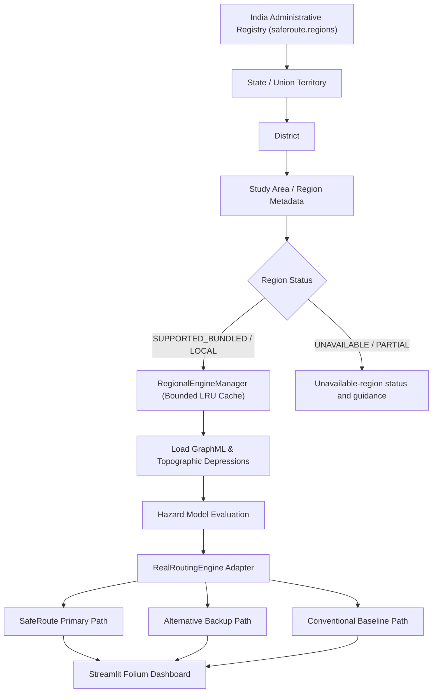

# Rakshapath

**AI-Assisted Emergency Routing and Disaster Response**

*Safer Routes. Smarter Rescue. Stronger India.*

Rakshapath explores how hazard-aware routing can support emergency response during natural disasters across India. Its verified foundational pilot is the Daraganj riverbank corridor in Prayagraj, Uttar Pradesh. It combines cached OpenStreetMap road networks, terrain elevations, and scenario-based hazard models to compare routes for different emergency vehicles.

> **Scope Note:** Nationwide-capable regional architecture is established; nationwide data coverage is a progressive expansion goal. Daraganj is the only validated hazard-model pilot. Varanasi, Mumbai Kurla, and Delhi Yamuna have routable OpenStreetMap road graphs for synthetic demos; their 50 m elevation placeholders and hazard scores are dummy values and are not emergency guidance.

---

## The Problem

Conventional navigation systems optimize strictly for travel time or shortest road distance. In disaster scenarios, the geometrically shortest route frequently cuts through low-lying corridors, submerged underpasses, or debris-blocked roads. Furthermore, road passability differs fundamentally by vehicle: an ambulance, fire tender, and heavy rescue truck have drastically different water-clearance thresholds.

Rakshapath compares:
1. **SafeRoute (Primary):** Risk-aware path minimizing travel time plus passability hazard penalty ($t + \lambda \cdot (-\ln p)$).
2. **Alternative Backup:** Distinct path penalized for overlapping with the primary corridor.
3. **Conventional Baseline:** Shortest-path Dijkstra route without hazard awareness.

---

## Current Implementation

- **Validated Pilot Area:** Daraganj, Prayagraj (2 km radius, 1,823 nodes, 4,740 edges) serving as the bundled golden regression baseline.
- **Regional Coverage:** The catalog is a small set of city corridors, not state-wide or nationwide coverage. Daraganj is the only calibrated pilot. Varanasi (5,029 nodes, 12,647 directed edges), Mumbai Kurla (20,685 nodes, 49,281 directed edges), and Delhi Yamuna (16,948 nodes, 44,507 directed edges) have local OpenStreetMap road graphs for synthetic routing demos only. Each uses a flat 50 m dummy elevation and uncalibrated hazard outputs; none is emergency guidance. Chennai Adyar, Bengaluru Bellandur, and Guwahati Brahmaputra remain unavailable until road data is obtained and checked. See each region's `metadata.json` for extract provenance and graph counts.
- **Regional Engine Cache:** A thread-safe LRU retains at most two engines. This bounds entries in that cache only; process RSS also depends on active requests, Python, and loaded libraries, so it is not a process memory cap or a hosting-tier guarantee.
- **Location Validation:** Requests must fall inside the selected region's declared bounding box, then snap only to a road within that region's configurable 500 m default tolerance.
- **Dynamic Metric Coordinate Scaling:** Cosine-scaled metric projection ($\cos(\phi)$) ensuring distance errors $< 0.15\%$ across all Indian latitudes (8°N–37°N).
- **Road & Terrain Processing:** Offline library pipeline (`saferoute/ingestion/pipeline.py`) processes caller-supplied graph and elevation data, extracts the Largest Strongly Connected Component (SCC), fills missing elevations, and precomputes depressions. The current `scripts/ingest_region.py` CLI only lists and validates assets; it does not fetch new regional data.
- **Flood Scenario:** The flood model is validated only for Daraganj. Varanasi, Mumbai, and Delhi use the same code over synthetic flat placeholder terrain and are explicitly labeled dummy demos; outputs are not meaningful flood estimates.
- **Earthquake Scenario:** Exploratory debris and shaking vulnerability simulation; explicitly labeled as an exploratory scenario, not a live seismic forecast.
- **Vehicle Profiles:** Modeled water-clearance thresholds are Ambulance (28 cm), Fire Tender (50 cm), and Rescue Truck (65 cm), as defined in `config.py` and `saferoute/config.py`.
- **Interface:** Streamlit dashboard with cascading administrative selectors (State $\to$ District $\to$ Region), status badges, Folium map overlays, elevation profiles, and benchmark resets.

---

## Architecture

Rakshapath uses a modular, on-demand regional architecture:



For architecture details, data schemas, cache behavior, and limitations, see [`docs/nationwide_architecture.md`](docs/nationwide_architecture.md).

---

## Routing Methodology

- **Primary (SafeRoute):** Minimizes the modeled sum of travel time and passability hazard penalty:
  $$\text{cost} = t + \lambda \times (-\ln p)$$
  where $\lambda = 120\text{ s}$ and pass probability is bounded by a numerical floor of $10^{-6}$. Edge travel time includes depth-dependent water slowdown.
- **Alternative Backup:** Penalizes edges shared with the primary route to discover distinct emergency corridors. Evaluates route cost, reliability, and corridor overlap percentage.
- **Baseline:** Minimizes total geometric road length without hazard awareness. Serves as the conventional shortest-path benchmark.

Reliability is calculated as the multiplicative end-to-end product of segment pass probabilities ($\prod p_i$), computed via log-sum ($\exp(\sum \ln p_i)$) for numerical stability.

---

## Regional Ingestion & Reproducible Benchmarks

### Ingestion CLI

List regions and validate already-prepared regional assets:

```bash
# List all registered regions and support status
python scripts/ingest_region.py --list

# Validate local assets for a region
python scripts/ingest_region.py --region daraganj_prayagraj --validate-only
```

The current CLI does not download or ingest new datasets. The pipeline is available as a Python API; prepare new assets offline before processing them.

### Reproducible Benchmark Suite

Run the 300 deterministic OD pair benchmark (seed 42, distance $\ge 1.5$ km) for Ambulance and Rescue Truck under severe flood conditions:

```bash
python scripts/run_benchmarks.py --region daraganj_prayagraj --samples 300 --min-dist 1500 --seed 42
```

Outputs are exported to `data/benchmark_results_daraganj_prayagraj.json` and `data/benchmark_plot_daraganj_prayagraj.png`.

#### Recorded Benchmark Summary (Daraganj Golden Baseline):
- **Asset Load Time:** 0.674 s
- **Traced Python Peak Allocation:** 27.26 MiB in the legacy run (not process RAM; RSS was not recorded)
- **Routing Success Rate:** 100.0% (300/300 pairs connected)
- **First-Route Latency:** 105.34 ms (Ambulance), 666.62 ms (Rescue Truck)
- **Subsequent Route Mean Latency:** 607.65 ms (Ambulance), 521.98 ms (Rescue Truck)
- **Mean Primary Reliability:** Ambulance 0.52% (Baseline 0.0%), Rescue Truck 75.50% (Baseline 62.58%)
- **Rank 1 Corridor Benchmark:** Primary 22.25% vs Baseline 0.06% (>20% absolute gain)
- **Data Coverage:** 100.0% elevation coverage, 100.0% depression coverage

---

## Installation & Local Execution

Use Python 3.12. The application runs from the repository root:

```bash
python -m venv .venv
```

Activate the environment in your shell:

```powershell
# Windows PowerShell
.\.venv\Scripts\Activate.ps1
```

```bash
# macOS / Linux
source .venv/bin/activate
```

Install pinned dependencies and launch the application:

```bash
python -m pip install -r requirements.txt
python -m pip check
python -m streamlit run app.py
```

---

## Testing

Run the full automated test suite covering registry, ingestion, routing integration, geographic projection, and UI workflows:

```bash
python -m unittest discover tests -v
```

**Status: 99 passed, 0 failures, 0 errors.**

---

## Honest Coverage Claims & Limitations

- **Nationwide-Capable $\neq$ Full Nationwide Data:** The registry contains a limited set of study regions across a subset of states and districts; it is not a complete nationwide administrative catalog. **Daraganj, Prayagraj** is the only validated hazard-model pilot. **Varanasi, Mumbai Kurla, and Delhi Yamuna** have OSM road graphs for synthetic routing demonstrations only; their elevation, hazard impact, passability, and reliability values are dummy or uncalibrated. Chennai, Bengaluru, and Guwahati remain `UNAVAILABLE` until their road data is obtained and checked.
- **Regional Benchmark $\neq$ Proof of Nationwide Safety:** The 300-pair benchmark is conducted exclusively on the validated Daraganj network to demonstrate algorithmic scaling and reliability separation; it does not claim safety in uningested territories.
- **Hazard Models:** Flood routing is the validated Daraganj pilot model. Earthquake debris remains a synthetic scenario. Cyclone, landslide, and wildfire are now available as **synthetic demos only**: their inputs and edge-impact values are invented, are not observations or forecasts, and must not be used for emergency decisions. The demo scores use simple illustrative graph attributes and are not calibrated hazard models.
- **Cloud Deployment:** The app is a single Streamlit service; no separate React frontend or Python API is part of the current architecture. Deployment memory has not been measured or guaranteed; measure process RSS in the target environment before relying on a particular service tier.

### Render

Create a Python web service for this repository and select the branch containing the release. Use the repository root as the service root, install dependencies with `python -m pip install -r requirements.txt`, and set the start command to:

```bash
python -m streamlit run app.py --server.address 0.0.0.0 --server.port $PORT
```

### Streamlit Community Cloud

In Community Cloud, create an app and configure the GitHub repository `mrfrosty7007/saferoute-ai`, the published branch containing the release, and `app.py` as the entrypoint. In **Advanced settings**, select Python 3.12. Community Cloud installs dependencies from the root `requirements.txt`; the checked-in graph and depression assets are required. The default workflow needs no secrets. Do not enter a Render start command in the Community Cloud app settings. See the [Community Cloud deployment guide](https://docs.streamlit.io/deploy/streamlit-community-cloud/deploy-your-app/deploy) and [dependency guide](https://docs.streamlit.io/deploy/streamlit-community-cloud/deploy-your-app/app-dependencies).

No public deployment URL is configured in this repository, and hosted behavior has not been verified.

---

## Roadmap

1. Build a regional registry and offline ingestion pipeline *(implemented as library code; current CLI only lists and validates assets; coverage remains limited)*.
2. Implement an LRU cache limited to two regional engine entries *(Completed; this is not a process memory cap)*.
3. Establish reproducible 300-pair empirical benchmark *(Completed)*.
4. Obtain and validate road-network assets for the remaining planned corridors, then acquire real terrain and independently validate regional hazard models before making safety claims.
5. Develop historical-data-based ML flood prediction and validate independently against CWC gauge records.
6. Replace synthetic cyclone, landslide, and wildfire demos with regionally calibrated models backed by documented hazard data.
7. Integrate live hospital destination matching and emergency dispatch routing.
